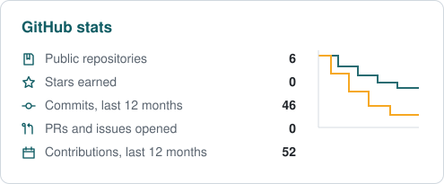
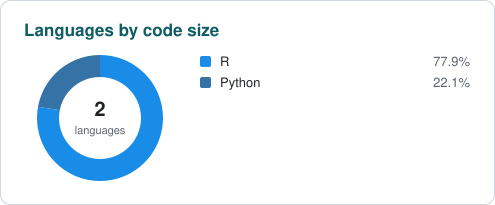

  

  
  
  

### About me

I'm a biostatistician (M.S., Applied Biostatistics). I work with researchers,
clinicians and health-data teams on study design and analysis, from sample
size and analysis plans through to tables and figures for publication.

<table>
  <tr>
    <td width="50%" valign="top">
      <b>Clinical trials</b> 
      Sample size, survival analysis (KM, Cox, competing risks, multi-state), CDISC ADaM data, safety summaries
    </td>
    <td width="50%" valign="top">
      <b>Causal inference</b> 
      Propensity scores, IPW, g-formula and AIPW for observational data
    </td>
  </tr>
  <tr>
    <td width="50%" valign="top">
      <b>Evidence synthesis</b> 
      Network meta-analysis, league tables, SUCRA rankings
    </td>
    <td width="50%" valign="top">
      <b>Interactive reporting</b> 
      R Shiny dashboards and shinylive apps that run in the browser
    </td>
  </tr>
</table>

### Toolbox

  
  
  
  
  
  
  
  
  
  

### Selected projects

<table>
  <tr>
    <td width="50%" valign="top">
      <h4><a href="https://github.com/xxxisuuu/glp1-obesity-evidence-toolkit">GLP-1 Obesity Evidence Toolkit</a></h4>
      Phase 3 sample size under FDA safety-exposure requirements, plus a network meta-analysis of semaglutide, tirzepatide and liraglutide trials.  
      
      
      
    </td>
    <td width="50%" valign="top">
      <h4><a href="https://github.com/xxxisuuu/colon-cancer-survival">Colon Cancer Survival</a></h4>
      Adjuvant chemotherapy trial: Kaplan-Meier, Cox models, subgroup forest plot, competing risks and multi-state models.  
      
      
    </td>
  </tr>
  <tr>
    <td width="50%" valign="top">
      <h4><a href="https://github.com/xxxisuuu/trial-explorer-shiny">Trial Explorer</a></h4>
      Shiny dashboard for CDISC pilot ADaM data: demographics, adverse event butterfly and volcano plots, Kaplan-Meier.  
      
      
      
    </td>
    <td width="50%" valign="top">
      <h4><a href="https://github.com/xxxisuuu/nhefs-causal-inference">NHEFS Causal Inference</a></h4>
      Effect of quitting smoking on weight gain, estimated with propensity scores, IPW, g-formula and AIPW.  
      
      
    </td>
  </tr>
  <tr>
    <td colspan="2" valign="top">
      <h4><a href="https://github.com/xxxisuuu/Multiple-Linear-Regression-Dashboard">Multiple Linear Regression Dashboard</a></h4>
      Teaching app for multiple linear regression (least squares, sampling distributions, confidence intervals, F vs t tests) that runs in the browser with shinylive.  
      
      
      
    </td>
  </tr>
</table>

### GitHub activity

  <picture>
    <source media="(prefers-color-scheme: dark)" srcset="assets/stats/stats-dark.svg"/>
    
  </picture>
  <picture>
    <source media="(prefers-color-scheme: dark)" srcset="assets/stats/langs-dark.svg"/>
    
  </picture>

  <picture>
    <source media="(prefers-color-scheme: dark)" srcset="https://raw.githubusercontent.com/xxxisuuu/xxxisuuu/output/github-snake-dark.svg"/>
    
  </picture>

---

  Open to consulting and collaboration on clinical and health-data projects.

